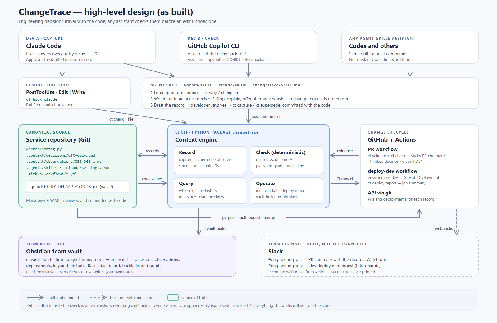

# ChangeTrace guide

ChangeTrace keeps the *reasons* behind code changes in the repository, next to the code, and checks them before someone undoes them.

A decision is a small Markdown file in `.context/decisions/`, reviewed and committed with the change it explains. It can carry a **guard** — "this setting, in this file, should be this value". The `ct` command reads those records, explains them, and warns when a change would undo one. The check is a plain comparison, not an AI, so it gives the same answer every time, however the record is worded.



- [Install](#install)
- [Set up a repository](#set-up-a-repository)
- [Everyday use](#everyday-use)
- [Record format](#record-format)
- [What the check catches](#what-the-check-catches)
- [Using it with AI assistants](#using-it-with-ai-assistants)
- [GitHub pull requests and deployments](#github-pull-requests-and-deployments)
- [Slack notifications (optional)](#slack-notifications-optional)
- [Obsidian team vault (optional)](#obsidian-team-vault-optional)
- [Command reference](#command-reference)
- [Troubleshooting](#troubleshooting)

---

## Install

You need Python 3.11 or newer and Git. The GitHub CLI (`gh`) is optional; with it, `ct` links records to pull requests and deployments.

```powershell
pip install "changetrace @ git+https://github.com/balkars/changetrace@main"
```

Check it works:

```powershell
ct --help
```

`ct` and `changetrace` are the same command.

## Set up a repository

From inside the repository you want to use it in:

```powershell
ct init --project "Worker service" --claude-hooks --github
```

This writes only inside the repository:

| File | What it is |
|---|---|
| `.context/config.yml` | Project name, base branch, environments |
| `.context/decisions/`, `.context/observations/` | Where records live |
| `.agents/skills/changetrace/SKILL.md` and `.claude/skills/changetrace/SKILL.md` | The instructions assistants follow (same file twice: Codex/Copilot read the first, Claude Code the second) |
| A line in `AGENTS.md`, `CLAUDE.md`, `.github/copilot-instructions.md` | Points each assistant at the skill |
| `.claude/settings.json` (with `--claude-hooks`) | Project-level Claude Code hook that runs the check after every edit |
| `.github/workflows/` (with `--github`) | Pull request check and dev deployment report |

It never touches your user-level settings (`~/.claude`, `~/.copilot`, …). Running it again is safe.

Then open `.context/config.yml` and set the GitHub repository, so `ct` can find pull requests and deployments:

```yaml
project: Worker service
base_branch: main
github: your-org/your-repo
environments: [dev]
```

Commit everything `ct init` created.

## Everyday use

The running example: `worker/config.py` has

```python
RETRY_DELAY_SECONDS = int(os.getenv("RETRY_DELAY_SECONDS", 2))
```

and you change the default to `0` so failed jobs recover faster.

### 1. Record a decision

Make the code change first, then write a draft. Only `title` and a `## Decided` section are required:

```markdown
---
title: Immediate retry for failed jobs
---

## Problem
Failed jobs waited two seconds before the first retry, which slowed recovery.

## Decided
Default RETRY_DELAY_SECONDS is 0, so a failed job retries immediately.

## Tried and ruled out
Keeping the delay and changing the queue consumer: more code, same effect.

## Watch out
Restoring 2 brings back slow recovery. Immediate retries can burst against a downstream service that is down.
```

Save it (say as `draft.md`) and capture it:

```powershell
ct capture --from-diff --input draft.md
```

```
Saved CTX-001 → .context/decisions/CTX-001-immediate-retry-for-failed-jobs.md
```

`--from-diff` looks at your uncommitted change and adds the guard for you: `RETRY_DELAY_SECONDS` should be `0` (it was `2`). Commit the record **in the same commit** as the code.

You can also pipe the draft in (`--input -`). In PowerShell:

```powershell
@'
---
title: Immediate retry for failed jobs
---

## Decided
Default RETRY_DELAY_SECONDS is 0.
'@ | ct capture --from-diff --input -
```

Capture refuses drafts — and changed values — that look like secrets (keys, tokens, passwords, Slack webhook URLs), and says which line, without printing the value.

### 2. Look before you change something

```powershell
ct why RETRY_DELAY_SECONDS
```

```
CTX-001 · active · Dev A · 2026-11-20 — Immediate retry for failed jobs
  Decided: Default RETRY_DELAY_SECONDS is 0, so a failed job retries immediately.
  Watch out: Restoring 2 brings back slow recovery. …
  Evidence: commit 8aa6865 · PR #1 · dev deploy 067194e
  Observed: OBS-001 · dev · deployment 3 — Request burst on dev
```

`ct why` takes a setting name, `file#SETTING`, a file path, or a record id (`CTX-001` shows that decision and anything that replaced it; `OBS-001` shows the decision the observation is about). `ct explain <file>` lists every record about a file. Newer decisions come first; replaced ones follow, marked `superseded`.

### 3. Check a change

```powershell
ct check
```

If someone sets the delay back to `2`:

```
✗ worker/config.py — changes RETRY_DELAY_SECONDS from 0 to 2 — this restores the value CTX-001 moved away from
  CTX-001 · Dev A · 2026-11-20: Immediate retry for failed jobs
  Decided: Default RETRY_DELAY_SECONDS is 0, so a failed job retries immediately.
  Watch out: Restoring 2 brings back slow recovery. …
1 conflict(s)
```

Exit code `1` means a conflict; `0` means none. `ct check` looks at everything that differs from where your branch left `main`: committed, staged, unstaged and new files.

| Option | Use |
|---|---|
| `--file worker/config.py` | Only this file |
| `--staged` | Only what is staged (what the next commit would contain) |
| `--base origin/main` | Compare against a different ref |
| `--format json` / `--format markdown` | For scripts / for a PR comment |

It never blocks anything by itself: it explains, and you decide.

### 4. Change a decision on purpose

If the old decision is wrong now, replace it rather than editing it. Write a draft for the new decision and run:

```powershell
ct supersede CTX-001 --from-diff --input draft.md
```

This creates `CTX-002` (which `supersedes: [CTX-001]`) and marks `CTX-001` as `superseded`. The original stays in history. Commit both with the code change; `ct check` then shows the change as resolved.

### 5. Record what happened

When something is observed after a deployment, attach it to the decision instead of editing the decision:

```powershell
@'
---
title: Request burst on dev
---

## Observed
After deployment 3, failed jobs retried immediately and the payments API saw bursts.
'@ | ct observe --about CTX-001 --env dev --deployment 3 --input -
```

The observation (`OBS-001`) then shows up under `ct why` and `ct history`.

### 6. Look back

```powershell
ct history --key RETRY_DELAY_SECONDS
```

```
2026-11-20  value      RETRY_DELAY_SECONDS 2 → 0 (commit 8aa6865)
2026-11-20  record     CTX-001 Retry failed jobs immediately by default (active)
2026-11-20  record     OBS-001 Request burst on dev (observation about CTX-001)
2026-11-20  deployment dev deploy 067194e (success)
```

```powershell
ct dev-since yesterday
```

lists each dev deployment since then, with the pull requests and records it brought in. `WHEN` can be `yesterday`, `2d`, `5h` or a date (`2026-11-01`).

## Record format

```markdown
---
id: CTX-001
kind: decision
title: Immediate retry for failed jobs
status: active                # proposed | active | superseded | rejected
author: Dev A
created: '2026-11-20'
touches: [worker/config.py#RETRY_DELAY_SECONDS]
guards:
- {file: worker/config.py, key: RETRY_DELAY_SECONDS, expect: '0', previous: '2'}
supersedes: []
superseded_by: null
tags: [worker, retry]
---

## Problem
## Decided
## Tried and ruled out
## Assumptions
## Watch out
## Evidence
```

- **IDs**: `CTX-NNN` for decisions, `OBS-NNN` for observations, next free number in your clone. If two branches pick the same number, `ct validate` fails in CI and `ct renumber` fixes your branch.
- **Guards** are optional. Without one, a record still shows up as relevant context; it just can't raise a conflict.
- **Records are append-only once merged.** Change a decision with `ct supersede`; record later facts with `ct observe`. `ct check` flags edits to a merged record's text, deleting or renaming a record, and changing its status by hand.
- **Commit SHAs and PR numbers are never stored** — they are looked up when needed, so rebases and squash merges don't break links.
- No chat transcripts are stored, ever.

## What the check catches

Guards can point at a setting in:

| File | How the value is found |
|---|---|
| `.py` | A module-level assignment, including defaults inside `os.getenv("X", 0)` / `os.environ.get(...)` wrapped in `int()` / `float()` / `str()` / `bool()` |
| `.yml` / `.yaml`, `.json`, `.toml` | A dotted path, e.g. `rate_limit.requests_per_minute` |
| `.env` | `KEY=value` lines |
| anything else | A `KEY = value` / `KEY: value` line (a warning if the key appears more than once with different values) |

`0`, `0.0` and `"0"` count as the same value.

| You'll see | When |
|---|---|
| **conflict** (✗, exit 1) | A guarded value no longer matches; a guarded setting was removed; a merged record was edited, deleted, renamed or had its status changed by hand |
| **resolved** (✓) | The change also adds a record that supersedes the old one |
| **warning** | `ct` can't read the value reliably (a computed value, an assignment inside an `if`, `+=`, duplicate keys…). It never treats "can't read it" as "fine" — read the record yourself |
| **info** (i) | The file has records but no guard here; or the change adds a new decision |

## Using it with AI assistants

`ct init` installs one skill file that Claude Code, GitHub Copilot and Codex all read. It tells the assistant to:

1. look up decisions (`ct why` / `ct explain`) before editing;
2. if a change would undo an active decision, **stop before editing**, explain the decision, its warning and evidence, offer alternatives and ask — a request to make the change is not treated as permission to override;
3. after a meaningful change, draft a record, show it, and run `ct capture` / `ct supersede` only after you say yes.

**Claude Code** also gets a project-level hook (`ct init --claude-hooks`): after every edit it runs the check on the edited file and tells Claude about any conflict or warning, even if the skill wasn't followed.

**Copilot CLI** asks before each shell command; choose "approve for this session" for `ct` so it doesn't interrupt you every time. The first time you open a repository it may ask you to trust the folder.

## GitHub pull requests and deployments

`ct init --github` adds two workflows. They install `ct` from this repository.

**`changetrace-pr.yml`** runs on every pull request:

- `ct validate` and `ct check --base origin/<base> --format markdown`
- posts or updates one comment on the PR: *"1 linked decision · 0 conflicts"*, with each record's Decided and Watch out
- the job fails on a conflict (or a validation problem) — merging is still your team's call
- optional Slack notice when the PR opens

**`deploy-dev.yml`** runs on every push to `main`:

- a job in the `dev` environment, so GitHub records a real Deployment
- a step marked *stand-in* that runs the tests — **replace it with your real deploy**
- `ct deploy report` writes what this deployment added (PRs, records) to the run's summary, and to Slack if configured

Both use the repository's own `GITHUB_TOKEN`; no extra GitHub secrets are needed. On your machine, `ct why` / `ct history` / `ct dev-since` use your `gh` login for the same links; without it they still work and say `links unavailable (offline or gh not logged in)`.

## Slack notifications (optional)

1. Go to **api.slack.com/apps** → **Create New App** → **From a manifest**, pick your workspace, paste [`slack/manifest.yml`](slack/manifest.yml), and install it.
2. In the app, open **Incoming Webhooks**, turn them on, and add one webhook for your PR channel and one for your dev channel. Copy the URLs — they start with `https://hooks.slack.com/services/`.
3. Add them as repository secrets (paste the URL when asked):

```powershell
gh secret set SLACK_WEBHOOK_PRS -R your-org/your-repo
```

```powershell
gh secret set SLACK_WEBHOOK_DEV -R your-org/your-repo
```

If a secret is missing, the workflows print `Slack not configured — skipped` and carry on. If it holds something other than a webhook URL (a bot token, the signing secret), they print that it is not a Slack webhook URL. The URL itself is never printed.

## Obsidian team vault (optional)

Build one browsable vault from several repositories. List local clones in a hub file:

```yaml
repos:
  - name: Worker service
    path: ../worker
    github: your-org/worker      # optional: adds deployment notes
  - name: API service
    path: ../api
```

```powershell
ct vault build --hub hub.yml --out team-vault
```

Open `team-vault` in Obsidian. You get one note per decision and observation (with links between superseded decisions), a note per guarded setting and per file, deployment notes, an overview, and a `Dashboards/Decisions` page (Markdown table and an Obsidian Bases view).

The vault is a read-only view: every note says *edit in the repository, not here*. Rebuilding only replaces the files ChangeTrace wrote itself — your own notes in the vault, anywhere, are never deleted or overwritten — and it refuses to build into a non-empty folder it didn't create.

## Command reference

| Command | What it does |
|---|---|
| `ct init [--project NAME] [--claude-hooks] [--github]` | Set up a repository |
| `ct capture [--from-diff] [--input FILE\|-]` | Record a decision |
| `ct supersede OLD_ID [--from-diff] [--input FILE\|-]` | Replace a decision |
| `ct observe --about ID --env ENV [--deployment N] [--input FILE\|-]` | Record an observation |
| `ct why TARGET` | Records behind a setting, `file#SETTING`, file or record id |
| `ct explain PATH` | Records that touch a file |
| `ct check [--base REF] [--staged] [--file PATH] [--format text\|json\|markdown]` | Conflict check (exit 1 on conflict) |
| `ct history --key KEY` | Timeline of a setting |
| `ct dev-since WHEN [--env ENV]` | Deployments since WHEN |
| `ct validate` | Problems in the records (exit 1 on any) — for CI |
| `ct renumber` | Fix record ids that clash with `main` |
| `ct vault build --hub FILE --out DIR` | Build the Obsidian vault |
| `ct deploy report --sha SHA [--env ENV] [--run-number N]` | Used by the deploy workflow |
| `ct notify slack pr --pr N` | Used by the PR workflow |
| `ct hook claude` | Used by the Claude Code hook |

Every command takes `--repo PATH` (default: the repository you're in) and `--help`.

## Troubleshooting

| Symptom | Fix |
|---|---|
| `links unavailable (offline or gh not logged in)` | Run `gh auth login`, and set `github:` in `.context/config.yml` |
| `duplicate id CTX-00N` in CI | Another branch took the same number; run `ct renumber` on yours and commit |
| `guard … expects 0, found 2` from `ct validate` | The code no longer matches an active decision; supersede the decision or restore the value |
| `draft contains a possible secret (line N: …)` | Remove the secret from the draft (or from the changed value) |
| A warning instead of a conflict | `ct` couldn't read the value exactly; read the record and check by hand |
| PR comment missing | Check the workflow has `pull-requests: write` permission and ran on the PR |
| Slack messages missing | See [Slack notifications](#slack-notifications-optional) |
| `ct` not found in PowerShell | Use the Python environment you installed it into, e.g. `.venv\Scripts\ct.exe`, or add its `Scripts` folder to `PATH` |

## More

- Design and decisions: [`docs/superpowers/specs/2026-11-18-changetrace-design.md`](docs/superpowers/specs/2026-11-18-changetrace-design.md)
- Live demo runbook and presenter script: [`docs/demo/`](docs/demo/)
