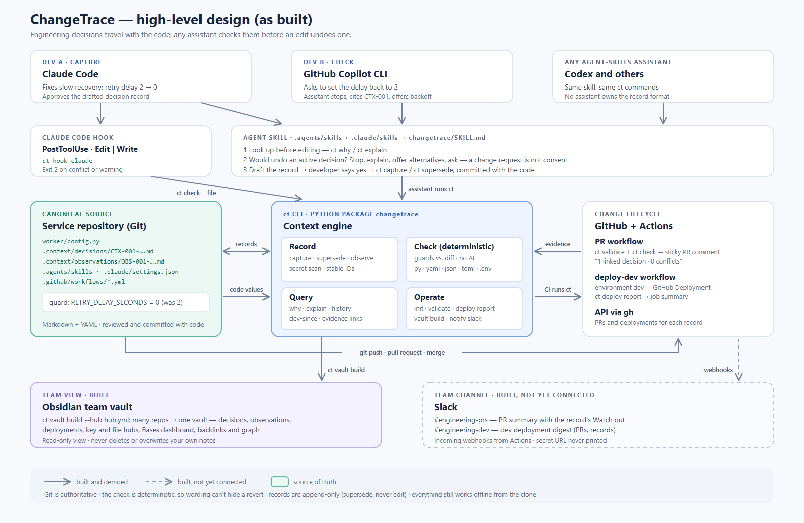

# ChangeTrace

Keep the reasons behind code changes next to the code, and get warned before a change undoes one.

```powershell
pip install "changetrace @ git+https://github.com/balkars/changetrace@main"
ct init --project "My service" --claude-hooks --github
```

**How to use it: [GUIDE.md](GUIDE.md)**


